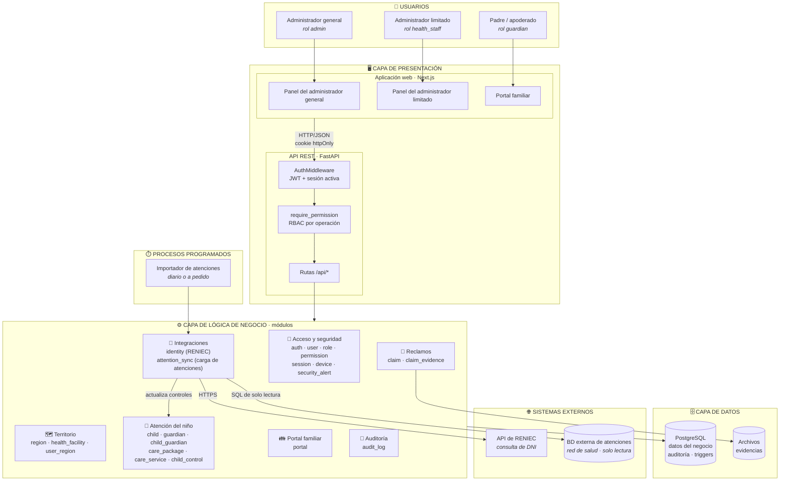

# Arquitectura inicial del sistema

## Diagrama de arquitectura

## Descripción

La arquitectura inicial se organiza en **tres capas principales**, más los procesos programados y los sistemas externos:

| Capa | Qué contiene | Responsabilidad |
|---|---|---|
| **Presentación** | Aplicación web (Next.js) con 3 interfaces, una por tipo de usuario, y la API REST (FastAPI) | Mostrar la información y recibir las peticiones. Antes de llegar al negocio, cada petición pasa por dos filtros: **autenticación** (JWT y sesión activa) y **autorización** (permiso de la operación). |
| **Lógica de negocio** | Los módulos del backend, agrupados en 7 áreas | Aplicar las reglas: quién puede hacer qué, cuándo un control es válido, qué ve cada padre, cómo se cargan las atenciones. |
| **Datos** | PostgreSQL y el almacenamiento de archivos | Guardar la información, reforzar la integridad y registrar la auditoría. |
| **Procesos programados** | Importador de atenciones | Traer cada cierto tiempo las atenciones de la base externa, sin bloquear a los usuarios. |
| **Sistemas externos** | API de RENIEC y BD externa de atenciones | Fuentes oficiales de identidad y de atenciones. |

## Áreas de la lógica de negocio

| Área | Módulos | Para qué sirve | Usuario principal |
|---|---|---|---|
| 🔐 Acceso y seguridad | `auth`, `user`, `role`, `permission`, `session`, `device`, `security_alert` | Quién entra, qué puede hacer y la detección de riesgos | Administrador general |
| 🗺️ Territorio | `region`, `health_facility`, `user_region` | Micro redes, establecimientos y asignación del personal | Administrador general |
| 👶 Atención del niño | `child`, `guardian`, `child_guardian`, `care_package`, `care_service`, `child_control` | El núcleo del negocio: niños, familias, catálogo y controles CRED | Administrador limitado |
| 📝 Reclamos | `claim`, `claim_evidence` | Reclamos de las familias y sus evidencias | Padre / Administrador limitado |
| 👪 Portal familiar | `portal` | Vista de los padres: sus hijos, sus controles y sus reclamos | Padre / apoderado |
| 🔌 Integraciones | `identity`, `attention_sync` | Consulta de DNI en RENIEC y carga de atenciones desde la BD externa | Administradores |
| 📜 Auditoría | `audit_log` | Consulta del historial de cambios | Administrador general |

## Flujos principales

| Flujo | Recorrido |
|---|---|
| Registrar un niño | Administrador limitado → panel → API → `identity` (consulta RENIEC) → `child` → PostgreSQL |
| Registrar un control | Administrador limitado → panel → API → `child_control` → PostgreSQL (trigger de auditoría) |
| Carga de atenciones | Importador → `attention_sync` → BD externa (lectura) → `child_control` → PostgreSQL |
| Consultar el portal | Padre → portal → API → `portal` → `child`, `child_control`, `claim` → PostgreSQL |
| Presentar un reclamo | Padre → portal → API → `portal` → `claim` / `claim_evidence` → PostgreSQL y archivos |

> Esta es la vista **inicial** (de alto nivel). Cómo se organiza cada módulo por dentro se explica en [Patrón arquitectónico](03-patron-arquitectonico.md) y en el [Modelo C4](../04-modelo-c4/nivel-3-componentes.md).
