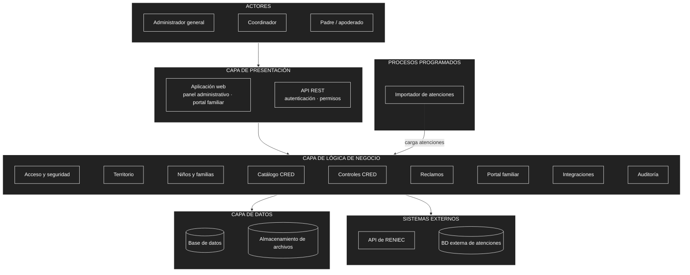

# Arquitectura inicial del sistema

## Diagrama de arquitectura

## Descripción

La arquitectura inicial se organiza en **tres capas principales**:

- **Presentación:** permite que los usuarios interactúen con el sistema mediante la aplicación web (panel administrativo y portal familiar) y la API REST. Antes de llegar al negocio, cada petición se **autentica** y se verifica que el usuario tenga **permiso** para la operación.
- **Lógica de negocio:** contiene los módulos responsables de las funcionalidades del sistema: acceso y seguridad, territorio, niños y familias, catálogo CRED, controles CRED, reclamos, portal familiar, integraciones y auditoría.
- **Datos:** almacena y consulta la información en una base de datos, y guarda los archivos de evidencia de los reclamos.

Además:

- El módulo de **Integraciones** se comunica con la **API de RENIEC** (consulta de DNI) y con la **BD externa de atenciones** de la red de salud (solo lectura).
- El **Importador de atenciones** es un proceso programado que trae las atenciones cada cierto tiempo sin bloquear a los usuarios.

## Módulos de la lógica de negocio

| Módulo | Responsabilidad | Usuario principal |
|---|---|---|
| **Acceso y seguridad** | Usuarios, roles, permisos, sesiones y alertas de seguridad | Administrador general |
| **Territorio** | Micro redes, establecimientos de salud y asignación del personal | Administrador general |
| **Niños y familias** | Padrón de niños, sus padres o apoderados y la relación entre ellos | Coordinador |
| **Catálogo CRED** | Paquetes y prestaciones de atención según la edad del niño | Administrador general |
| **Controles CRED** | Controles programados, realizados y vencidos de cada niño | Coordinador |
| **Reclamos** | Reclamos de las familias y sus evidencias | Padre / Coordinador |
| **Portal familiar** | Vista de los padres: sus hijos, el avance de sus controles y sus reclamos | Padre / apoderado |
| **Integraciones** | Consulta de identidad en RENIEC y carga de atenciones desde la BD externa | Administradores |
| **Auditoría** | Historial de cambios: quién hizo qué y cuándo | Administrador general |
