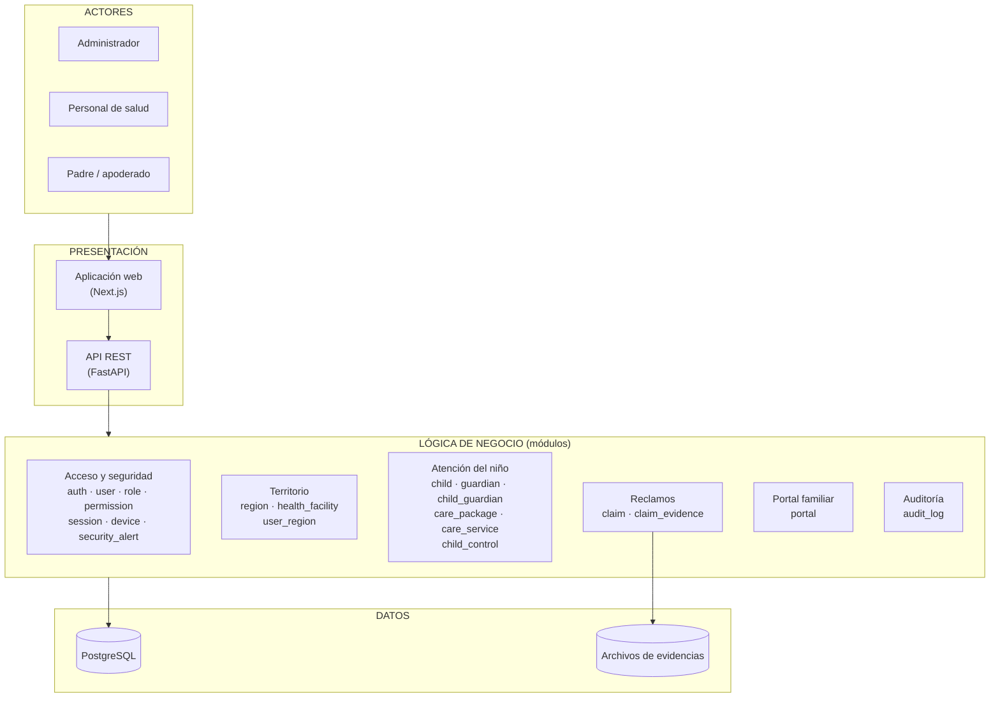

# Arquitectura inicial del sistema

## Diagrama de arquitectura

## Descripción

La arquitectura inicial se organiza en tres capas principales:

- **Presentación:** la aplicación web (Next.js), con la que interactúan los tres tipos de usuario, y la API REST (FastAPI), que recibe las peticiones.
- **Lógica de negocio:** los 19 módulos del backend, agrupados aquí en 6 áreas para facilitar la lectura.
- **Datos:** PostgreSQL guarda la información del negocio y la auditoría; las evidencias de los reclamos se guardan como archivos.

| Área | Módulos | Para qué sirve |
|---|---|---|
| Acceso y seguridad | `auth`, `user`, `role`, `permission`, `session`, `device`, `security_alert` | Quién entra, qué puede hacer y la detección de riesgos |
| Territorio | `region`, `health_facility`, `user_region` | Micro redes, establecimientos y asignación del personal |
| Atención del niño | `child`, `guardian`, `child_guardian`, `care_package`, `care_service`, `child_control` | El núcleo del negocio: niños, familias, catálogo y controles CRED |
| Reclamos | `claim`, `claim_evidence` | Reclamos de las familias y sus evidencias |
| Portal familiar | `portal` | Vista de los padres: sus hijos, sus controles y sus reclamos |
| Auditoría | `audit_log` | Consulta del historial de cambios |

> Esta es la vista **inicial** (de alto nivel). Cómo se organiza cada módulo por dentro se explica en [Patrón arquitectónico](03-patron-arquitectonico.md) y en el [Modelo C4](../04-modelo-c4/nivel-3-componentes.md).
