# Estilo arquitectónico

Se utiliza el estilo arquitectónico: **monolito modular + capas**.

| Pregunta | Respuesta en SICNA |
|---|---|
| ¿Cómo se despliega? | **Monolito**: todo el backend es una sola aplicación, con un solo despliegue y una sola base de datos. |
| ¿Cómo se divide? | **Modular**: un módulo por cada área del negocio (acceso, territorio, niños, catálogo, controles, reclamos, portal, integraciones y auditoría). |
| ¿Cómo se organiza por dentro? | **Capas**: cada módulo atraviesa las mismas capas: presentación, lógica de negocio y datos. |

> *Capas = organización lógica; monolito = unidad de despliegue. Ambos coexisten.*

## Diagrama del estilo

```mermaid
%%{init: {"theme": "base", "themeVariables": {"primaryColor": "#ffffff", "primaryTextColor": "#111827", "primaryBorderColor": "#475569", "lineColor": "#64748b", "textColor": "#111827", "titleColor": "#111827", "edgeLabelBackground": "#ffffff", "clusterBkg": "#f8fafc", "clusterBorder": "#94a3b8"}, "flowchart": {"wrappingWidth": 600}}}%%
flowchart TB
    A1["👤 Administrador general"]
    A2["👤 Coordinador"]
    A3["👤 Padre / apoderado"]

    WEB["<b>Cliente web</b><br/>[Navegador · aplicación web]"]

    subgraph MONO["«monolito»#nbsp;SICNA#nbsp;Backend#nbsp;[Python#nbsp;·#nbsp;FastAPI]#nbsp;—#nbsp;una#nbsp;sola#nbsp;aplicación#nbsp;·#nbsp;un#nbsp;solo#nbsp;despliegue"]
        direction TB

        subgraph L1["1#nbsp;·#nbsp;CAPA#nbsp;DE#nbsp;PRESENTACIÓN#nbsp;—#nbsp;recibe#nbsp;peticiones#nbsp;HTTP,#nbsp;autentica,#nbsp;valida#nbsp;la#nbsp;entrada#nbsp;y#nbsp;responde#nbsp;JSON"]
            direction TB
            MW["<b>Middleware transversal</b><br/>autenticación (JWT) · sesión activa · permisos · validación de entrada · manejo de errores"]
            subgraph P[" "]
                direction LR
                p1["Acceso y seguridad<br/><i>rutas → controlador</i>"]
                p2["Territorio<br/><i>rutas → controlador</i>"]
                p3["Niños y familias<br/><i>rutas → controlador</i>"]
                p4["Catálogo CRED<br/><i>rutas → controlador</i>"]
                p5["Controles CRED<br/><i>rutas → controlador</i>"]
                p7["Portal familiar<br/><i>rutas → controlador</i>"]
                p9["Auditoría<br/><i>rutas → controlador</i>"]
                p6["Reclamos<br/><i>rutas → controlador</i>"]
                p8["Integraciones<br/><i>rutas → controlador</i>"]
            end
            MW --> P
        end

        subgraph L2["2#nbsp;·#nbsp;CAPA#nbsp;DE#nbsp;LÓGICA#nbsp;DE#nbsp;NEGOCIO#nbsp;—#nbsp;reglas#nbsp;del#nbsp;negocio#nbsp;y#nbsp;coordinación#nbsp;entre#nbsp;módulos"]
            direction LR
            s1["<b>Servicio · Acceso y seguridad</b><br/>login, roles, permisos, alertas"]
            s2["<b>Servicio · Territorio</b><br/>micro redes, establecimientos"]
            s3["<b>Servicio · Niños y familias</b><br/>niños, padres, vínculos"]
            s4["<b>Servicio · Catálogo CRED</b><br/>paquetes y prestaciones"]
            s5["<b>Servicio · Controles CRED</b><br/>controles y su estado"]
            s7["<b>Servicio · Portal familiar</b><br/>vista del padre"]
            s9["<b>Servicio · Auditoría</b><br/>historial de cambios"]
            s6["<b>Servicio · Reclamos</b><br/>reclamos y evidencias"]
            s8["<b>Servicio · Integraciones</b><br/>RENIEC, carga de atenciones"]
        end

        subgraph L3["3#nbsp;·#nbsp;CAPA#nbsp;DE#nbsp;DATOS#nbsp;—#nbsp;persistencia#nbsp;y#nbsp;consultas#nbsp;a#nbsp;la#nbsp;base#nbsp;de#nbsp;datos"]
            direction TB
                r1["Repositorio · Acceso y seguridad"]
                r2["Repositorio · Territorio"]
                r3["Repositorio · Niños y familias"]
                r4["Repositorio · Catálogo CRED"]
                r5["Repositorio · Controles CRED"]
                r7["Repositorio · Portal familiar"]
                r9["Repositorio · Auditoría"]
                r6["Repositorio · Reclamos"]
                r8["Repositorio · Integraciones"]
            DA["<b>Acceso a datos compartido</b><br/>conexión · transacciones · contexto de auditoría"]
        end
    end

    DB[("<b>PostgreSQL</b><br/>una sola base de datos")]
    FS[("<b>Almacenamiento de archivos</b><br/>evidencias")]
    RENIEC["«sistema externo»<br/><b>API de RENIEC</b>"]
    BDEXT[("«sistema externo»<br/><b>BD externa de atenciones</b>")]
    IMP["«proceso programado»<br/><b>Importador de atenciones</b><br/>(mismo código, cada noche)"]

    A1 & A2 & A3 -->|usan| WEB
    WEB -->|"HTTPS · JSON<br/>/api"| MW

    p1 --> s1 --> r1
    p2 --> s2 --> r2
    p3 --> s3 --> r3
    p4 --> s4 --> r4
    p5 --> s5 --> r5
    p6 --> s6 --> r6
    p7 --> s7 --> r7
    p8 --> s8 --> r8
    p9 --> s9 --> r9

    r1 & r2 & r3 & r4 & r5 & r6 & r7 & r8 & r9 --> DA
    DA -->|"SQL"| DB
    s6 -->|guarda evidencias| FS
    s8 -->|"HTTPS / REST"| RENIEC
    s8 -->|"SQL · solo lectura"| BDEXT
    IMP -->|ejecuta la carga| s8

    classDef actor fill:#e0f2fe,stroke:#0369a1,color:#0c4a6e
    classDef pres fill:#ffffff,stroke:#2563eb,color:#111827
    classDef serv fill:#ffffff,stroke:#16a34a,color:#111827
    classDef repo fill:#ffffff,stroke:#d97706,color:#111827
    classDef ext fill:#e5e7eb,stroke:#4b5563,color:#111827
    class A1,A2,A3,WEB actor
    class MW,p1,p2,p3,p4,p5,p6,p7,p8,p9 pres
    class s1,s2,s3,s4,s5,s6,s7,s8,s9 serv
    class r1,r2,r3,r4,r5,r6,r7,r8,r9,DA repo
    class DB,FS,RENIEC,BDEXT,IMP ext

    style MONO fill:#f8fafc,stroke:#334155,stroke-width:2px,stroke-dasharray:8 5,color:#0f172a
    style L1 fill:#dbeafe,stroke:#2563eb,stroke-width:2px,color:#1e3a8a
    style P fill:none,stroke:none
    style L2 fill:#dcfce7,stroke:#16a34a,stroke-width:2px,color:#14532d
    style L3 fill:#fef3c7,stroke:#d97706,stroke-width:2px,color:#78350f
```

### Leyenda

| Símbolo | Significado |
|---|---|
| Flecha continua | Llamada síncrona entre capas (de arriba hacia abajo) |
| Recuadro punteado | Límite del monolito: una sola aplicación y un solo despliegue |
| Columna | Un módulo del negocio, que atraviesa las tres capas |
| Recuadro gris | Sistema externo o proceso fuera de la petición HTTP |

### Reglas de la arquitectura

1. Cada capa solo invoca a la capa inmediatamente inferior.
2. Un módulo no accede al repositorio ni a las tablas de otro módulo.
3. La comunicación entre módulos se hace llamando a su servicio (por ejemplo, Controles CRED consulta a Niños y familias y al Catálogo CRED).
4. Todo el backend se despliega como una sola aplicación con una sola base de datos.

## ¿Por qué este estilo?

| Estilo | Motivo de la elección |
|---|---|
| **Monolito** | Un solo despliegue y una sola base de datos: simple para un equipo pequeño (RC09) y con transacciones consistentes entre niños, controles y reclamos. |
| **Modular** | Cada módulo tiene su propio dominio y se comunica con los demás solo a través de su servicio, así que un cambio en un módulo no rompe a otros (DA06). Si en el futuro un módulo crece mucho, se puede separar. |
| **Capas** | Separa la forma de recibir datos (HTTP), las reglas del negocio y la tecnología de almacenamiento dentro de cada módulo. |
