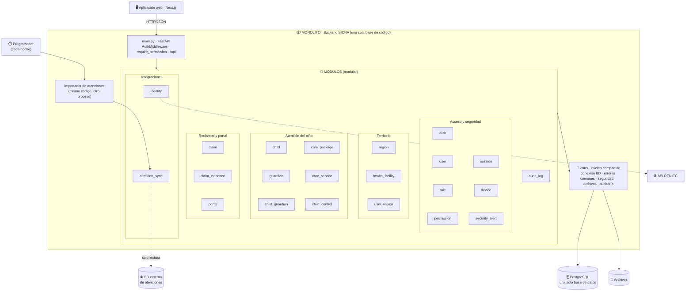
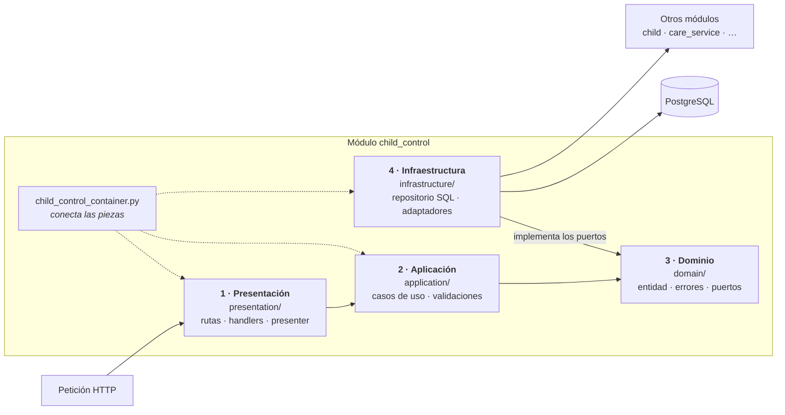

# Estilo arquitectónico

Se utiliza el estilo arquitectónico: **monolito modular + capas**.

| Pregunta | Respuesta en SICNA |
|---|---|
| ¿Cómo se despliega? | **Monolito**: todo el backend es una sola aplicación con una sola base de datos. El importador de atenciones usa el mismo código. |
| ¿Cómo se divide? | **Modular**: módulos independientes por dominio en `srs-back/src/modules/`. |
| ¿Cómo se organiza por dentro? | **Capas**: cada módulo tiene las mismas 4 capas (presentación, aplicación, dominio e infraestructura). |

> *Capas = organización lógica; monolito = unidad de despliegue. Ambos coexisten.*

## Diagrama general del estilo

## Diagrama de las capas dentro de un módulo

Todos los módulos repiten la misma estructura. Ejemplo con `child_control`:

| Capa | Responsabilidad | Ejemplo |
|---|---|---|
| **Presentación** | Recibir la petición HTTP, validar el formato y responder en JSON | `child_control_create_handler.py` |
| **Aplicación** | Coordinar el caso de uso y aplicar las reglas | `ChildControlCreateUseCase` |
| **Dominio** | Definir la entidad y las interfaces (puertos) que necesita | `ChildControl`, `ChildPort` |
| **Infraestructura** | Implementar las interfaces con una tecnología concreta | `AsyncpgChildControlRepository`, `ChildAdapter` |

## ¿Por qué este estilo?

| Estilo | Motivo de la elección |
|---|---|
| **Monolito** | Un solo despliegue y una sola base de datos: simple para un equipo pequeño (RC09) y con transacciones consistentes entre niños, controles y reclamos. |
| **Modular** | Cada módulo tiene su propio dominio y se comunica con los demás solo mediante puertos, así que un cambio en un módulo no rompe a otros (DA06). Si en el futuro un módulo crece mucho, se puede separar. |
| **Capas** | Separa la forma de recibir datos (HTTP), las reglas del negocio y la tecnología de almacenamiento dentro de cada módulo. |
