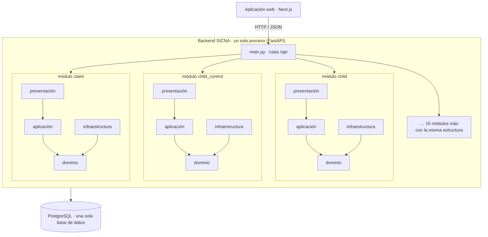

# Estilo arquitectónico

Se utiliza el estilo arquitectónico: **monolito modular + capas**.

| Pregunta | Respuesta en SICNA |
|---|---|
| ¿Cómo se despliega? | **Monolito**: todo el backend es una sola aplicación (`uvicorn main:app`) con una sola base de datos. |
| ¿Cómo se divide? | **Modular**: 19 módulos independientes por dominio en `srs-back/src/modules/`. |
| ¿Cómo se organiza por dentro? | **Capas**: cada módulo tiene las mismas 4 capas (presentación, aplicación, dominio e infraestructura). |

> *Capas = organización lógica; monolito = unidad de despliegue. Ambos coexisten.*

## Diagrama

## ¿Por qué este estilo y no otro?

| Estilo | ¿Se eligió? | Motivo |
|---|---|---|
| **Monolito modular** | ✅ Sí | Un solo despliegue, simple para un equipo pequeño (RC07), con módulos que mantienen el orden (DA04). |
| **Capas** | ✅ Sí | Separa responsabilidades dentro de cada módulo (ver Clean Architecture). |
| Cliente-servidor | Implícito | El frontend es el cliente y la API es el servidor, como en toda aplicación web. |
| Microservicios | ❌ No | Agrega red, varios despliegues y datos distribuidos sin necesidad en esta etapa. Gracias a los módulos, en el futuro se podría separar uno como servicio. |
| Event-Driven | ❌ No | No hay procesos asíncronos que lo justifiquen; las operaciones son peticiones y respuestas directas. |
| Serverless | ❌ No | La aplicación mantiene sesiones, auditoría y conexiones a la base de datos; un servidor tradicional es más simple. |
