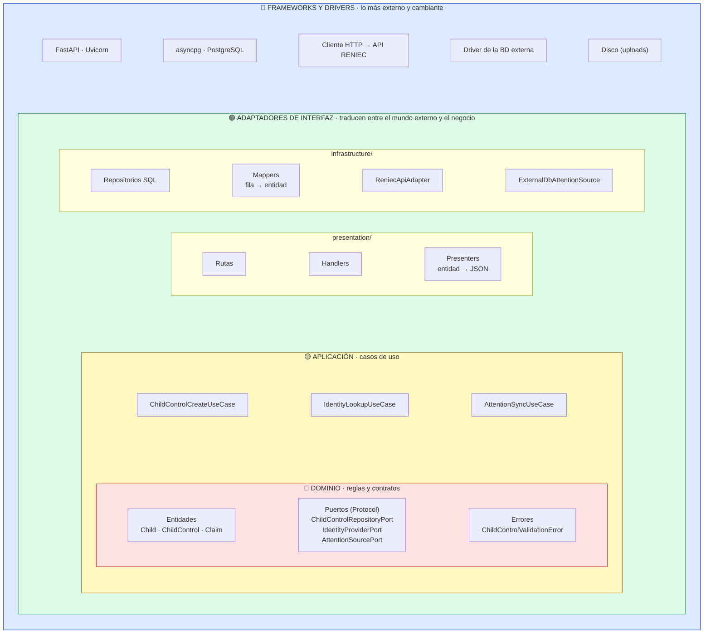
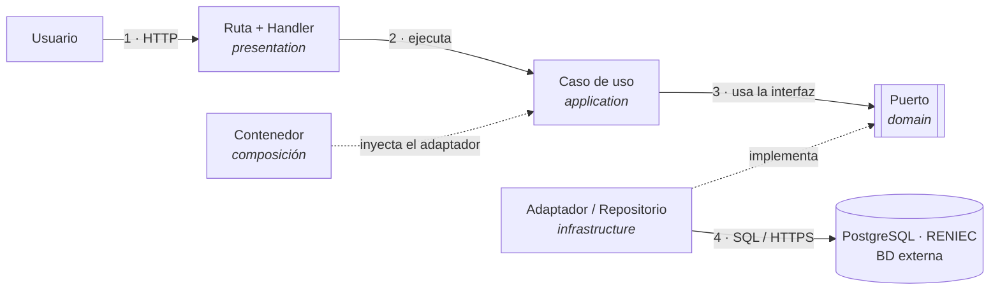

# Patrón arquitectónico

Se utiliza el patrón arquitectónico **Clean Architecture** (Arquitectura Limpia).

| Elemento | Descripción aplicada a SICNA |
|---|---|
| Patrón / enfoque arquitectónico | Clean Architecture, aplicada **dentro de cada módulo** del monolito. |
| Objetivo | Que las reglas del negocio (por ejemplo, "un control realizado debe tener fecha") no dependan de FastAPI, de PostgreSQL, de RENIEC ni de la base externa de atenciones. |
| ¿Qué problema resuelve? | Antes, la lógica estaba mezclada: los handlers capturaban errores de PostgreSQL, los servicios importaban los repositorios concretos y las entidades sabían leer filas de la base de datos. Además, con RENIEC y la base externa, sus formatos podrían contaminar el negocio. |
| Capas definidas | Dominio, Aplicación, Infraestructura y Presentación. |
| Regla de dependencia | El código solo importa **hacia el dominio**. El dominio no conoce a nadie. |
| Beneficios | • Las reglas se pueden probar sin base de datos ni RENIEC. • Cambiar una tecnología o un proveedor externo solo requiere un adaptador nuevo. • Todos los módulos tienen la misma estructura. |

## Los círculos de Clean Architecture en SICNA

> Cada círculo solo conoce a los que están **dentro** de él. El dominio (rojo) no sabe que existen FastAPI, PostgreSQL ni RENIEC.

| Círculo | Carpeta en SICNA | Qué contiene |
|---|---|---|
| 🔴 **Dominio** | `domain/` | Entidades (`ChildControl`), errores, puertos (`ChildControlRepositoryPort`, `ChildPort`, `IdentityProviderPort`, `AttentionSourcePort`) y referencias (`ChildRef`) |
| 🟡 **Aplicación** | `application/` | Casos de uso (`ChildControlCreateUseCase`, `AttentionSyncUseCase`…) y validaciones |
| 🟢 **Adaptadores de interfaz** | `presentation/` y `infrastructure/` | Rutas, handlers y presenters; repositorios, mappers y adaptadores (`ReniecApiAdapter`, `ExternalDbAttentionSource`) |
| 🔵 **Frameworks y drivers** | `main.py`, `core/`, `*_container.py` | FastAPI, asyncpg, cliente HTTP, configuración y conexión de las piezas |

## Regla de dependencia: cómo viaja una petición

Las **llamadas** van de afuera hacia adentro y de vuelta, pero las **dependencias del código** siempre apuntan hacia el dominio:

## Antes y después

| Aspecto | Antes (capas simples) | Después (Clean Architecture) |
|---|---|---|
| Servicio → repositorio | El servicio importaba la clase concreta con SQL | El caso de uso recibe una **interfaz** (`Protocol`) por el constructor |
| Errores de base de datos | Los handlers capturaban `UniqueViolationError` de asyncpg | El repositorio los traduce a errores propios (`AlreadyExistsError`) |
| Entidad | Tenía `from_row()` (leía filas) y `to_dict()` (armaba el JSON) | Es un `dataclass` puro; el mapper y el presenter están en sus capas |
| Módulo → otro módulo | Importaba el servicio del otro módulo directamente | Declara un **puerto** con lo mínimo que necesita; un adaptador lo implementa |
| Sistemas externos | — | RENIEC y la BD externa quedan detrás de `IdentityProviderPort` y `AttentionSourcePort` |

> **Cómo comprobarlo:** en ningún archivo de `domain/` ni de `application/` aparece `import fastapi`, `asyncpg` ni nada de `infrastructure/`. Lo verificamos con una búsqueda automática (ver [Verificación](../05-verificacion/01-verificacion-de-la-arquitectura.md)).
