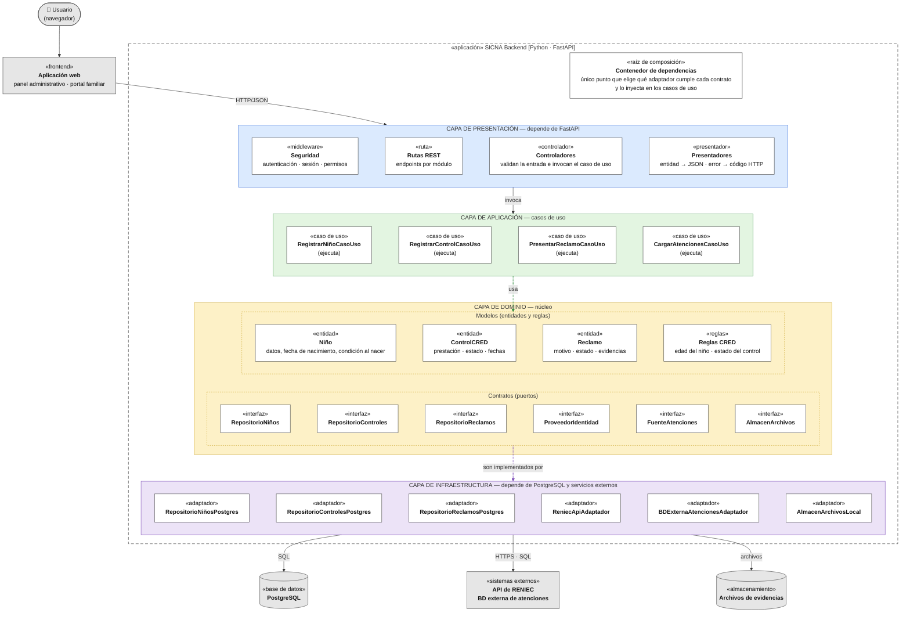

# Patrón arquitectónico

Se utiliza el patrón arquitectónico **Clean Architecture** (Arquitectura Limpia).

| Elemento | Descripción aplicada a SICNA |
|---|---|
| Patrón / enfoque arquitectónico | Clean Architecture, aplicada **dentro de cada módulo** del monolito. |
| Objetivo | Separar responsabilidades y hacer que las reglas del negocio (por ejemplo, "un control realizado debe tener fecha") no dependan de FastAPI, de PostgreSQL, de RENIEC ni de la base externa de atenciones. |
| ¿Qué problema resuelve? | Evita el acoplamiento entre la interfaz web, las reglas del negocio y las tecnologías externas (base de datos, API de RENIEC, BD externa de atenciones y almacenamiento de archivos). Sin esta separación, un cambio en el proveedor o en el formato de un sistema externo obligaría a modificar el negocio. |
| Capas definidas | Presentación, Aplicación, Dominio e Infraestructura. |
| Regla de dependencia | Las dependencias del código apuntan siempre **hacia el dominio**. El dominio no conoce a ninguna otra capa. |
| Beneficios | • Facilita el mantenimiento y las pruebas unitarias: las reglas se prueban sin base de datos ni RENIEC. • Cambiar una tecnología o un proveedor externo solo requiere un adaptador nuevo. • Todos los módulos siguen la misma estructura. |

## Diagrama de Clean Architecture en SICNA

### Reglas de dependencia

1. El dominio no importa nada de las capas externas.
2. Los casos de uso solo conocen entidades y contratos (puertos).
3. Los adaptadores implementan los contratos y son intercambiables.
4. Cambiar de tecnología o de proveedor significa cambiar el contenedor de dependencias, no el dominio.
