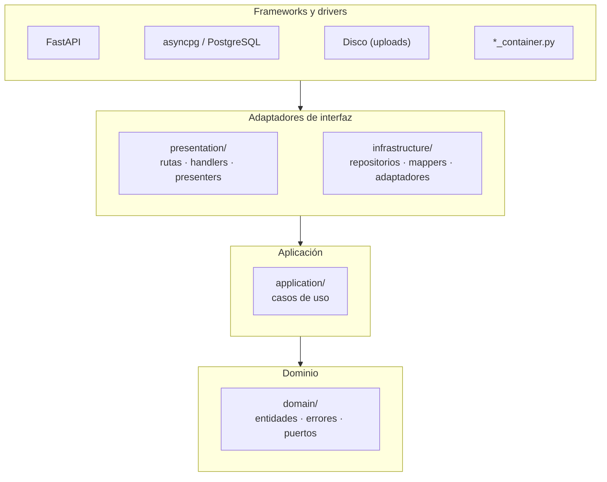

# Patrón arquitectónico

Se utiliza el patrón arquitectónico **Clean Architecture** (Arquitectura Limpia).

| Elemento | Descripción aplicada a SICNA |
|---|---|
| Patrón / enfoque arquitectónico | Clean Architecture, aplicada **dentro de cada módulo** del monolito. |
| Objetivo | Que las reglas del negocio (por ejemplo, "un control realizado debe tener fecha") no dependan de FastAPI, de PostgreSQL ni del disco. |
| ¿Qué problema resuelve? | Antes, la lógica estaba mezclada: los handlers capturaban errores de PostgreSQL, los servicios importaban los repositorios concretos y las entidades sabían leer filas de la base de datos. Cambiar una tecnología obligaba a tocar el negocio. |
| Capas definidas | Dominio, Aplicación, Infraestructura y Presentación. |
| Regla de dependencia | El código solo importa **hacia el dominio**. El dominio no conoce a nadie. |
| Beneficios | • Las reglas del negocio se pueden probar sin base de datos. • Se puede cambiar una tecnología (por ejemplo, el almacenamiento de archivos) creando solo un adaptador. • Todos los módulos tienen la misma estructura, así que es fácil saber dónde va cada archivo. |

## Los círculos de Clean Architecture en SICNA

| Círculo | Carpeta en SICNA | Qué contiene (ejemplo del módulo `child_control`) |
|---|---|---|
| **Dominio** | `domain/` | Entidad `ChildControl`, error `ChildControlValidationError`, puertos `ChildControlRepositoryPort`, `ChildPort`, `CareServicePort`… |
| **Aplicación** | `application/` | `ChildControlCreateUseCase`, `ChildControlUpdateUseCase`, reglas en `validate_child_control()` |
| **Adaptadores de interfaz** | `infrastructure/` y `presentation/` | `AsyncpgChildControlRepository`, `ChildAdapter`, `row_to_child_control()`; rutas, handlers y `child_control_to_dict()` |
| **Frameworks y drivers** | `main.py`, `core/`, `*_container.py` | FastAPI, asyncpg, configuración y conexión de las piezas |

## Antes y después

| Aspecto | Antes (capas simples) | Después (Clean Architecture) |
|---|---|---|
| Servicio → repositorio | El servicio importaba la clase concreta con SQL | El caso de uso recibe una **interfaz** (`Protocol`) por el constructor |
| Errores de base de datos | Los handlers capturaban `UniqueViolationError` de asyncpg | El repositorio los traduce a errores propios (`AlreadyExistsError`) |
| Entidad | Tenía `from_row()` (leía filas) y `to_dict()` (armaba el JSON) | Es un `dataclass` puro; el mapper y el presenter están en sus capas |
| Módulo → otro módulo | Importaba el servicio del otro módulo directamente | Declara un **puerto** con lo mínimo que necesita; un adaptador lo implementa |

> **Cómo comprobarlo:** en ningún archivo de `domain/` ni de `application/` aparece `import fastapi`, `asyncpg` ni nada de `infrastructure/`. Lo verificamos con una búsqueda automática (ver [Verificación](../05-verificacion/01-verificacion-de-la-arquitectura.md)).
