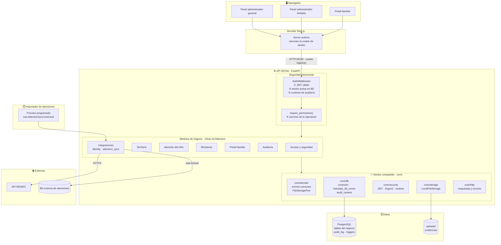
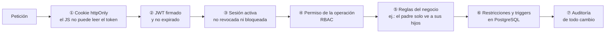

# Componentes arquitectónicos

Componentes que forman SICNA, su responsabilidad y cómo se conectan.

## Diagrama de componentes

## Componentes

| Componente | Tipo | Responsabilidad | Ubicación |
|---|---|---|---|
| **Aplicación web** | Frontend | Tres interfaces: panel del administrador general, panel del administrador limitado y portal familiar | `srs-front/` |
| **Server actions** | Frontend (servidor) | Llamar a la API desde el servidor de Next.js, reenviando la cookie de sesión | `srs-front/lib/actions/` |
| **AuthMiddleware** | Seguridad | Leer el JWT, verificar que la sesión siga activa en la base de datos y preparar el contexto de auditoría | `core/security/auth_middleware.py` |
| **require_permission** | Seguridad | Verificar en cada ruta que el usuario tenga el permiso necesario; es lo que diferencia al administrador general del limitado | `core/security/permission_guard.py` |
| **Módulos de negocio** | Backend | Cada uno con sus 4 capas y su contenedor | `src/modules/` |
| **identity** *(diseñado)* | Integración | Consultar un DNI en RENIEC y devolver los datos de identidad | `src/modules/identity/` |
| **attention_sync** *(diseñado)* | Integración | Leer la base externa, aplicar las atenciones a los controles y registrar el resultado de cada carga | `src/modules/attention_sync/` |
| **Importador de atenciones** *(diseñado)* | Proceso programado | Ejecutar `attention_sync` cada noche o a pedido del administrador general | `srs-back/scripts/` |
| **Núcleo compartido** | Backend | Conexión a la base de datos, errores comunes, respuestas HTTP, JWT, contraseñas y archivos | `src/core/` |
| **PostgreSQL** | Datos | Tablas del negocio, auditoría y triggers de integridad | `src/core/db/sql/` |
| **Almacenamiento de evidencias** | Datos | Archivos JPG, PNG o PDF de los reclamos | carpeta `uploads/` |
| **API de RENIEC** | Externo | Fuente oficial de datos de identidad | Servicio de RENIEC |
| **BD externa de atenciones** | Externo | Atenciones registradas por los establecimientos | Red de salud |

## Piezas del núcleo compartido (`core/`)

| Pieza | Capa de Clean | Para qué sirve |
|---|---|---|
| `core/domain/persistence_errors.py` | Dominio (compartido) | Errores `AlreadyExistsError`, `ReferenceNotFoundError` e `InvalidDataError`, que usan todos los módulos |
| `core/domain/file_storage_port.py` | Dominio (compartido) | Puerto `FileStoragePort` para guardar y borrar archivos |
| `core/db/db_errors.py` | Infraestructura | Decorador `translate_db_errors` que convierte errores de asyncpg en errores del dominio |
| `core/db/audit_context.py` | Infraestructura | Envía usuario, dispositivo e IP a PostgreSQL para que la auditoría los registre |
| `core/storage/file_storage.py` | Infraestructura | `LocalFileStorage`, que implementa `FileStoragePort` sobre el disco |
| `core/security/` | Infraestructura | JWT, cookies, Argon2 (contraseñas) y tokens de dispositivo |

## Seguridad en capas (defensa en profundidad)

