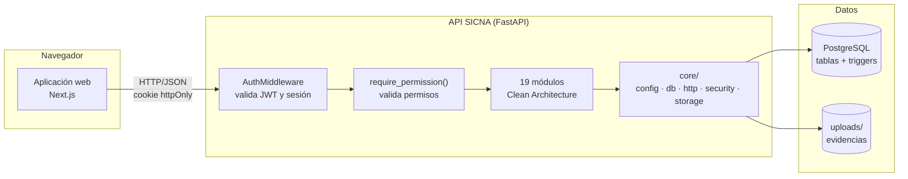

# Componentes arquitectónicos

Componentes que forman SICNA y la responsabilidad de cada uno.

## Vista general

## Componentes

| Componente | Tipo | Responsabilidad | Ubicación |
|---|---|---|---|
| **Aplicación web** | Frontend | Pantallas del administrador, del personal de salud y del portal familiar | `srs-front/` |
| **AuthMiddleware** | Seguridad | Lee el JWT de la cookie, verifica que la sesión siga activa en la base de datos y prepara el contexto de auditoría | `core/security/auth_middleware.py` |
| **require_permission** | Seguridad | Verifica en cada ruta que el usuario tenga el permiso necesario (`child.post`, `claim.put`…) | `core/security/permission_guard.py` |
| **Módulos de negocio** | Backend | 19 módulos, cada uno con sus 4 capas y su contenedor | `src/modules/` |
| **Núcleo compartido** | Backend | Conexión a la base de datos, errores de persistencia comunes, respuestas HTTP, JWT, contraseñas, almacenamiento de archivos | `src/core/` |
| **PostgreSQL** | Datos | Tablas del negocio, auditoría (`audit_log`) y triggers de integridad | `src/core/db/sql/` |
| **Almacenamiento de evidencias** | Datos | Archivos JPG, PNG o PDF de los reclamos | carpeta `uploads/` |

## Piezas compartidas del núcleo (`core/`)

| Pieza | Capa de Clean | Para qué sirve |
|---|---|---|
| `core/domain/persistence_errors.py` | Dominio (compartido) | Errores `AlreadyExistsError`, `ReferenceNotFoundError` e `InvalidDataError`, que usan todos los módulos |
| `core/domain/file_storage_port.py` | Dominio (compartido) | Puerto `FileStoragePort` para guardar y borrar archivos |
| `core/db/db_errors.py` | Infraestructura | Decorador `translate_db_errors` que convierte errores de asyncpg en errores del dominio |
| `core/storage/file_storage.py` | Infraestructura | `LocalFileStorage`, que implementa `FileStoragePort` sobre el disco |
| `core/db/audit_context.py` | Infraestructura | Envía usuario, dispositivo e IP a PostgreSQL para que la auditoría los registre |
| `core/security/` | Infraestructura | JWT, cookies, Argon2 (contraseñas) y tokens de dispositivo |
