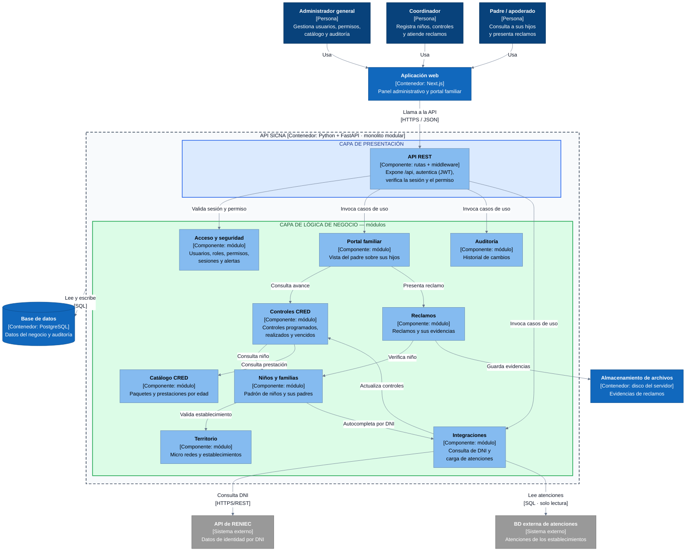
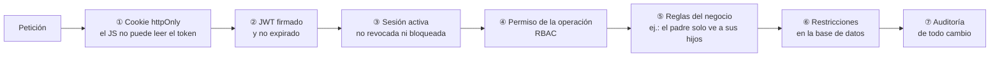

# Componentes arquitectónicos · Modelo C4

Vista de componentes de SICNA según el **Modelo C4 · Nivel 3 (componentes)**, con el estilo **monolito modular en capas**. Se abre el contenedor **API SICNA** y se muestran sus componentes: la API REST y los módulos del negocio, cómo se relacionan entre sí y con los contenedores y sistemas externos.

## Diagrama de componentes

### Leyenda

| Color | Elemento |
|---|---|
| Azul oscuro | Persona |
| Azul | Contenedor |
| Celeste | Componente |
| Gris | Sistema externo |

Flecha: relación con verbo y [protocolo]. Línea discontinua: límite del contenedor.

### Notas

- Cada componente es un módulo del monolito: todos se despliegan juntos.
- Un módulo usa a otro solo a través de su interfaz pública (su servicio), nunca sus tablas.
- El **Importador de atenciones** (proceso programado, contenedor aparte) no aparece en el diagrama: ejecuta cada noche el mismo módulo de Integraciones, sin pasar por la API REST, para no bloquear a los usuarios.

## Componentes

| Componente | Tipo | Responsabilidad |
|---|---|---|
| **API REST** | Componente | Recibir las peticiones, autenticar al usuario, verificar su sesión y su permiso, y derivar al módulo correspondiente |
| **Acceso y seguridad** | Módulo | Usuarios, roles, permisos, sesiones, dispositivos y alertas de seguridad |
| **Territorio** | Módulo | Micro redes, establecimientos de salud y asignación del personal |
| **Niños y familias** | Módulo | Padrón de niños, sus padres o apoderados y la relación entre ellos |
| **Catálogo CRED** | Módulo | Paquetes y prestaciones de atención según la edad del niño |
| **Controles CRED** | Módulo | Controles de cada niño y su estado (programado, realizado, vencido) |
| **Reclamos** | Módulo | Reclamos de las familias y sus archivos de evidencia |
| **Portal familiar** | Módulo | Vista del padre: solo sus hijos, sus controles y sus reclamos |
| **Auditoría** | Módulo | Consulta del historial de cambios (quién, qué y cuándo) |
| **Integraciones** | Módulo | Consulta de DNI en RENIEC y carga de atenciones desde la BD externa |
| **Importador de atenciones** | Contenedor (proceso programado) | Ejecutar la carga de atenciones cada noche o a pedido del administrador general |
| **Base de datos** | Contenedor | Datos del negocio, auditoría y reglas de integridad |
| **Almacenamiento de archivos** | Contenedor | Archivos JPG, PNG o PDF de los reclamos |
| **API de RENIEC** | Sistema externo | Fuente oficial de datos de identidad |
| **BD externa de atenciones** | Sistema externo | Atenciones registradas por los establecimientos de la red de salud |

## Seguridad en capas (defensa en profundidad)

