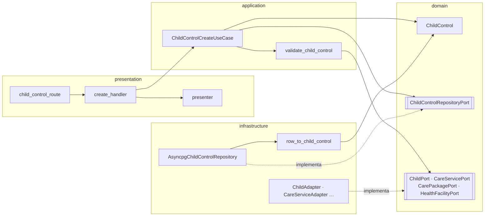
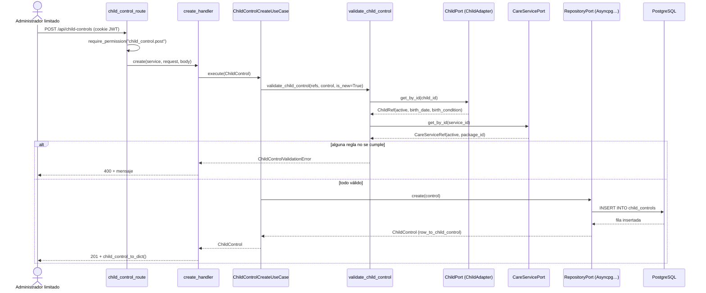
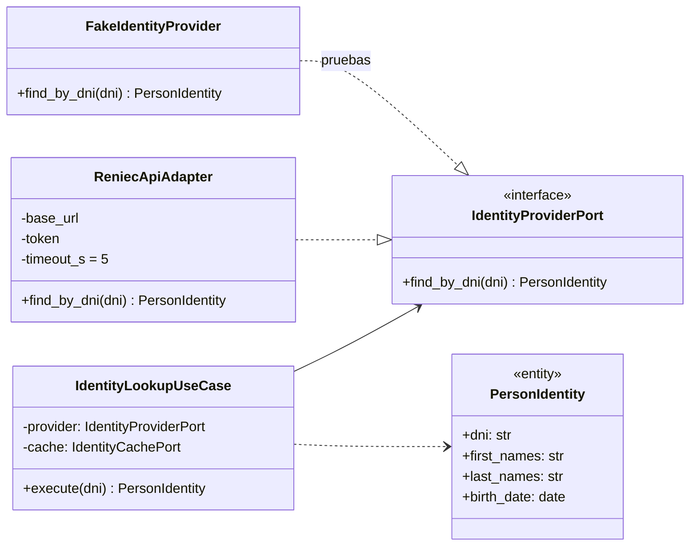
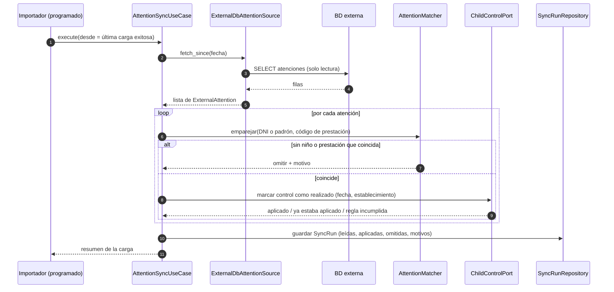

# Diseño interno de módulos

> **Proyecto:** SICNA · **Backend:** Python + FastAPI · **Módulo de referencia:** Controles CRED (`child_control`)
> **Enfoque arquitectónico:** Clean Architecture dentro de cada módulo del monolito modular
> **Nivel C4:** 4 – Código

---

## 1. Propósito

Este documento describe **cómo se organiza el código dentro de un módulo** del backend, para que:

- los 19 módulos se construyan con la misma estructura;
- las reglas de negocio queden aisladas de FastAPI y de PostgreSQL;
- cualquier integrante del equipo sepa dónde va cada archivo y de qué puede depender.

Se eligió `child_control` como referencia porque es el **núcleo del negocio** (los controles CRED) y es el módulo que más depende de otros: niños, prestaciones, paquetes y establecimientos.

---

## 2. Estructura de carpetas

```text
srs-back/src/modules/
└── child_control/
    ├── domain/
    │   ├── child_control_domain.py           Entidad ChildControl y tipo ControlStatus
    │   ├── child_control_errors.py           Error de validación del módulo
    │   ├── child_control_repository_port.py  Puerto (interfaz) de persistencia
    │   └── child_control_ports.py            Puertos hacia otros módulos + referencias (ChildRef…)
    ├── application/
    │   ├── child_control_validate.py         Reglas de negocio del control
    │   ├── child_control_create_use_case.py  Caso de uso: registrar control
    │   ├── child_control_update_use_case.py  Caso de uso: editar control
    │   ├── child_control_get_all_use_case.py
    │   ├── child_control_get_by_id_use_case.py
    │   ├── child_control_delete_use_case.py
    │   └── child_control_service.py          Agrupa los casos de uso (fachada del módulo)
    ├── infrastructure/
    │   ├── child_control_repository.py       AsyncpgChildControlRepository
    │   ├── child_control_*_repository.py     Una consulta SQL por operación
    │   ├── child_control_mapper.py           Fila de la BD → entidad
    │   └── child_control_adapters.py         Adaptadores hacia child, care_service, care_package, health_facility
    ├── presentation/
    │   ├── child_control_route.py            Rutas /api/child-controls
    │   ├── child_control_*_handler.py        Traducen HTTP ⇄ caso de uso
    │   ├── child_control_errors_handler.py   Error de BD → mensaje HTTP
    │   └── child_control_presenter.py        Entidad → JSON
    ├── seeders/                              Datos de prueba
    └── child_control_container.py            Raíz de composición del módulo
```

| Archivo | Capa | Responsabilidad | Importa de |
|---|---|---|---|
| `child_control_domain.py` | Dominio | Representar un control y sus estados | Nada |
| `child_control_ports.py` | Dominio | Declarar **qué** necesita el módulo de otros módulos | Nada |
| `child_control_repository_port.py` | Dominio | Declarar **qué** operaciones de persistencia necesita | Entidad |
| `child_control_validate.py` | Aplicación | Aplicar las reglas del control | Dominio |
| `child_control_create_use_case.py` | Aplicación | Coordinar: validar y luego guardar | Dominio |
| `child_control_repository.py` | Infraestructura | Guardar y leer controles en PostgreSQL | Dominio + asyncpg |
| `child_control_adapters.py` | Infraestructura | Consultar otros módulos y traducir sus datos a referencias propias | Dominio + otros módulos |
| `child_control_create_handler.py` | Presentación | Leer la petición, invocar el caso de uso y responder | Aplicación + dominio |
| `child_control_container.py` | Composición | Crear las piezas concretas y conectarlas | Todas |

---

## 3. Capas del módulo y regla de dependencia



**Regla de dependencia:** el código solo importa **hacia el centro** (el dominio). El dominio no conoce FastAPI, asyncpg ni los otros módulos.

| Capa | Contiene | Puede depender de | **No** puede depender de |
|---|---|---|---|
| **Dominio** | Entidades, errores, puertos (`Protocol`), referencias (`ChildRef`) | Nada externo (solo el dominio compartido de `core/domain`) | Aplicación, infraestructura, presentación, FastAPI, asyncpg |
| **Aplicación** | Casos de uso, validaciones | Dominio | Infraestructura, presentación, FastAPI, asyncpg |
| **Infraestructura** | Repositorios, mappers, adaptadores | Dominio, asyncpg, otros módulos (por su contenedor) | Presentación |
| **Presentación** | Rutas, handlers, presenters, esquemas Pydantic | Aplicación, dominio | Infraestructura, base de datos |
| **Composición** | `child_control_container.py` | Todas | — |

---

## 4. Reglas de negocio del control

Están en `application/child_control_validate.py`. La base de datos las refuerza con el trigger `check_child_control_dates` y las restricciones `child_controls_completed_check` (RN-01) y `child_controls_unique` (RN-08).

| Código | Regla | Respuesta si no se cumple |
|---|---|---|
| RN-01 | Un control `completed` debe tener `completed_date`, y solo ese estado puede tenerla | 400 |
| RN-02 | El niño debe existir; al registrar un control nuevo, además debe estar activo | 400 |
| RN-03 | `completed_date` debe estar entre la fecha de nacimiento y hoy | 400 |
| RN-04 | `scheduled_date` no puede ser anterior a la fecha de nacimiento | 400 |
| RN-05 | La prestación debe existir y estar activa | 400 |
| RN-06 | Si el paquete es solo para recién nacidos en riesgo, el niño debe ser prematuro o de bajo peso | 400 |
| RN-07 | Si se indica un establecimiento, debe existir y estar activo | 400 |
| RN-08 | Un niño no puede tener dos controles de la misma prestación | 409 |

---

## 5. Flujo de ejecución: registrar un control



| Paso | Origen → destino | Acción | Capa |
|---|---|---|---|
| 1 | Administrador limitado → ruta | `POST /api/child-controls` | Presentación |
| 2 | Ruta | Verifica el permiso `child_control.post` | Presentación |
| 3 | Handler → caso de uso | Arma la entidad `ChildControl` y llama a `execute()` | Presentación → Aplicación |
| 4 | Caso de uso → validación | Aplica las reglas RN-01 a RN-07 | Aplicación |
| 5 | Validación → puertos | Consulta el niño, la prestación, el paquete y el establecimiento **mediante interfaces** | Aplicación → Dominio |
| 6 | Adaptadores → otros módulos | `ChildAdapter` llama al módulo `child` y devuelve un `ChildRef` | Infraestructura |
| 7 | Caso de uso → repositorio | `create(control)` | Aplicación → Dominio (interfaz) |
| 8 | Repositorio → PostgreSQL | `INSERT`; si hay duplicado, se traduce a `AlreadyExistsError` (RN-08) | Infraestructura |
| 9 | Handler → cliente | `201` con el control en JSON, o `400`/`409` con el mensaje | Presentación |

---

## 6. Código de referencia

### 6.1 Dominio · entidad y puertos

```python
# domain/child_control_domain.py
ControlStatus = Literal["pending", "completed", "overdue", "not_applicable"]

@dataclass
class ChildControl:
    id: UUID
    child_id: UUID
    service_id: UUID
    status: ControlStatus = "pending"
    scheduled_date: Optional[date] = None
    completed_date: Optional[date] = None
    health_facility_id: Optional[UUID] = None
    # … libro, lote, notas, auditoría
```

```python
# domain/child_control_ports.py
@dataclass(frozen=True)
class ChildRef:              # solo lo que el módulo necesita saber del niño
    id: UUID
    active: bool
    birth_date: date
    birth_condition: str

class ChildPort(Protocol):
    async def get_by_id(self, child_id: UUID) -> ChildRef | None: ...
```

### 6.2 Aplicación · caso de uso

```python
# application/child_control_create_use_case.py
class ChildControlCreateUseCase:
    def __init__(self, repository: ChildControlRepositoryPort, refs: ChildControlRefs):
        self.repository = repository      # interfaz, no PostgreSQL
        self.refs = refs                  # interfaces hacia otros módulos

    async def execute(self, child_control: ChildControl) -> ChildControl:
        await validate_child_control(self.refs, child_control, is_new=True, facility_changed=True)
        return await self.repository.create(child_control)
```

### 6.3 Infraestructura · adaptador y repositorio

```python
# infrastructure/child_control_adapters.py
class ChildAdapter:                       # implementa ChildPort
    async def get_by_id(self, child_id: UUID) -> ChildRef | None:
        child = await childService.get_by_id(child_id)     # módulo child
        if child is None:
            return None
        return ChildRef(id=child.id, active=child.active,
                        birth_date=child.birth_date, birth_condition=child.birth_condition)
```

```python
# infrastructure/child_control_repository.py
class AsyncpgChildControlRepository:      # implementa ChildControlRepositoryPort
    create = staticmethod(translate_db_errors(create_child_control))
    get_all = staticmethod(translate_db_errors(get_all_child_controls))
    # …
```

### 6.4 Presentación · ruta y handler

```python
# presentation/child_control_route.py
@router.post("", dependencies=[Depends(require_permission("child_control.post"))])
async def create_child_control(request: Request, body: ChildControlCreateRequest,
                               service: ChildControlService = Depends(get_child_control_service)):
    return await childControlHandler.create(service, request, body)
```

### 6.5 Raíz de composición

```python
# child_control_container.py
childControlService = ChildControlService(
    AsyncpgChildControlRepository(),               # cambiar de BD = cambiar esta línea
    ChildControlRefs(
        children=ChildAdapter(),
        care_services=CareServiceAdapter(),
        care_packages=CarePackageAdapter(),
        health_facilities=HealthFacilityAdapter(),
    ),
)

def get_child_control_service() -> ChildControlService:
    return childControlService
```

---

## 7. Diseño de los módulos de integración *(diseñado, pendiente de implementación)*

Los dos módulos nuevos siguen **exactamente la misma estructura de 4 capas**. Lo particular es que su infraestructura habla con sistemas externos en lugar de (o además de) PostgreSQL.

### 7.1 Módulo `identity` · consulta de DNI en RENIEC

```text
identity/
├── domain/
│   ├── identity_domain.py            PersonIdentity (dni, nombres, apellidos, fecha de nacimiento)
│   ├── identity_errors.py            IdentityNotFoundError, IdentityUnavailableError
│   ├── identity_provider_port.py     IdentityProviderPort (Protocol)
│   └── identity_cache_port.py        IdentityCachePort (Protocol)
├── application/
│   └── identity_lookup_use_case.py   IdentityLookupUseCase: valida el DNI, usa caché y consulta
├── infrastructure/
│   ├── reniec_api_adapter.py         ReniecApiAdapter: HTTPS + credenciales + tiempo límite
│   └── identity_cache.py             Caché de consultas recientes (evita consultas repetidas)
├── presentation/
│   └── identity_route.py             GET /api/identity/{dni}  (permiso identity.get)
└── identity_container.py
```



| Situación | Qué hace el sistema | Respuesta |
|---|---|---|
| DNI con formato inválido | El caso de uso lo rechaza sin llamar a RENIEC | 400 |
| DNI encontrado | Devuelve los datos para autocompletar el formulario | 200 |
| DNI no existe en RENIEC | `IdentityNotFoundError` | 404 |
| RENIEC no responde en 5 s | `IdentityUnavailableError`; el formulario se completa manualmente | 503 |

### 7.2 Módulo `attention_sync` · carga de atenciones desde la BD externa

```text
attention_sync/
├── domain/
│   ├── attention_sync_domain.py      ExternalAttention, SyncRun, SyncResult
│   ├── attention_source_port.py      AttentionSourcePort: leer atenciones desde una fecha
│   └── attention_sync_ports.py       Puertos hacia child, care_service y child_control
├── application/
│   ├── attention_sync_use_case.py    AttentionSyncUseCase: leer → emparejar → aplicar → registrar
│   └── attention_matcher.py          Reglas para emparejar cada atención con un niño y una prestación
├── infrastructure/
│   ├── external_db_attention_source.py  Lee la BD externa (conexión de solo lectura)
│   ├── attention_sync_repository.py     Guarda cada ejecución en attention_sync_runs
│   └── attention_sync_adapters.py       Adaptadores hacia child, care_service y child_control
├── presentation/
│   └── attention_sync_route.py       POST /api/attention-sync/run · GET /api/attention-sync/runs
└── attention_sync_container.py
```



| Regla de la carga | Motivo |
|---|---|
| Se leen solo las atenciones nuevas desde la última carga exitosa | Evita reprocesar todo cada noche |
| El niño se identifica por DNI y, si no tiene, por código de padrón | Son los identificadores que comparten ambas bases |
| La prestación se identifica por su código del catálogo SISNAT | Las dos bases usan el mismo catálogo normativo |
| Los controles se **actualizan**, no se duplican | La carga es idempotente (restricción `child_controls_unique`) |
| Cada actualización pasa por las mismas reglas RN-01 a RN-07 | Una atención externa no puede saltarse las reglas del negocio |
| Las atenciones que no se pueden aplicar se registran con su motivo | El administrador general puede revisarlas y corregirlas |
| Los cambios del importador quedan en la auditoría con el usuario técnico `importador` | Trazabilidad (AC02) |
