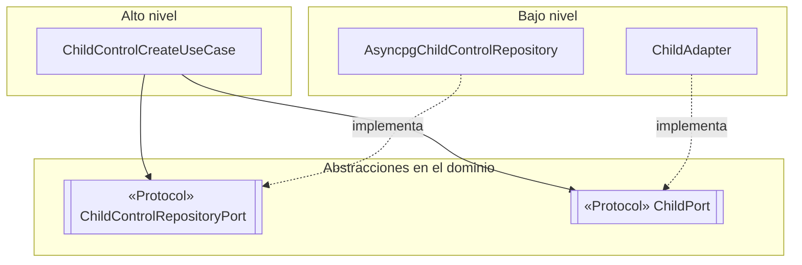

# Principios de diseño (SOLID)

## Objetivo

Mostrar cómo se cumplen los principios SOLID en el backend de SICNA, con ejemplos del código real.

## Contexto

- **Estilo:** monolito modular (Python + FastAPI).
- **Patrón arquitectónico:** Clean Architecture (presentación, aplicación, dominio, infraestructura).
- **Módulo de referencia:** Controles CRED (`child_control`).

> En Python las interfaces se escriben con `typing.Protocol`: cualquier clase que tenga los mismos métodos cumple la interfaz, sin necesidad de heredar de ella.

## SOLID en el módulo de controles

| Principio | Dónde se aplica (capa) | Cómo se cumple en SICNA | Archivos |
|---|---|---|---|
| **S** · Responsabilidad única | Todas las capas | Cada pieza tiene una sola tarea: la ruta verifica el permiso, el handler traduce HTTP, el caso de uso coordina, `validate_child_control` aplica las reglas, el repositorio escribe SQL, el mapper arma la entidad y el presenter arma el JSON | `child_control_route.py`, `*_handler.py`, `*_use_case.py`, `child_control_validate.py`, `*_repository.py`, `*_mapper.py`, `*_presenter.py` |
| **O** · Abierto/cerrado | Infraestructura | Para guardar evidencias en la nube se crea un adaptador nuevo que implemente `FileStoragePort`; los casos de uso de reclamos no se modifican | `core/domain/file_storage_port.py`, `core/storage/file_storage.py` |
| **L** · Sustitución de Liskov | Infraestructura y pruebas | Cualquier objeto que cumpla `ChildControlRepositoryPort` puede reemplazar al repositorio de PostgreSQL; en las pruebas del módulo `child` usamos un repositorio falso en memoria y los casos de uso funcionaron igual | `child_control_repository_port.py`, `child_repository_port.py` |
| **I** · Segregación de interfaces | Dominio | Cada módulo pide solo lo que usa: `child_control` necesita del niño únicamente `active`, `birth_date` y `birth_condition` (`ChildRef`), no los 19 campos de `Child`; `claim` solo pregunta si la prestación existe (`CareServicePort.exists`) | `child_control_ports.py`, `claim_ports.py` |
| **D** · Inversión de dependencias | Aplicación | El caso de uso recibe interfaces por el constructor y no conoce asyncpg ni los otros módulos; las implementaciones se conectan en el contenedor | `child_control_create_use_case.py`, `child_control_container.py` |

## Diagrama: inversión de dependencias

Tanto el caso de uso (alto nivel) como el repositorio (bajo nivel) dependen de la **abstracción**. Ninguno depende directamente del otro.

## Qué pasaría sin SOLID en SICNA

| Situación real | Sin SOLID (como estaba antes) | Con SOLID (como está ahora) |
|---|---|---|
| Cambiar PostgreSQL por otra base de datos | Había que tocar handlers y servicios, porque capturaban errores de asyncpg | Solo se cambian los repositorios y el traductor de errores |
| Guardar evidencias en la nube | Había que modificar el servicio de reclamos | Solo se crea un adaptador nuevo |
| Probar la regla "control completado necesita fecha" | Se necesitaba la base de datos real | Se prueba con repositorios falsos en memoria |
| El módulo `child` cambia su entidad | Se rompían los módulos que la usaban directamente | Solo se ajusta el adaptador que arma `ChildRef` |

## Relación con Clean Architecture y los patrones

| Principio | Lo cumple en el proyecto |
|---|---|
| Responsabilidad única | La separación en capas y los archivos de una sola operación |
| Abierto/cerrado y Liskov | Los patrones Adapter y Repository |
| Segregación de interfaces | Los puertos pequeños de cada módulo (`ChildPort`, `CareServicePort`, `FileStoragePort`) |
| Inversión de dependencias | La regla de dependencia de Clean Architecture y los contenedores |
