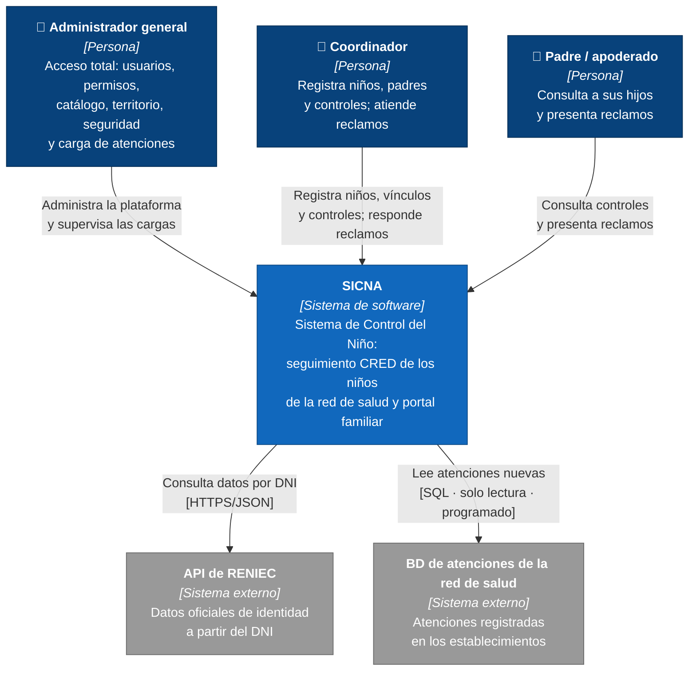

# Nivel 1 · Diagrama de contexto del sistema

> **Proyecto:** SICNA · **Modelo:** C4 · Nivel 1 de 4

---

## 1. Objetivo

Mostrar **SICNA como una sola caja**: quiénes lo usan y con qué sistemas externos se comunica.

| Aspecto | Descripción |
|---|---|
| Pregunta que responde | ¿Qué es el sistema, quién lo usa y con quién se integra? |
| Audiencia | Todos: red de salud, docentes, equipo de desarrollo |
| Qué **no** muestra | Tecnologías, servidores ni módulos internos |
| Siguiente nivel | [Nivel 2 · Contenedores](nivel-2-contenedores.md) |

---

## 2. Diagrama

---

## 3. Personas (usuarios)

| Persona | Rol | Qué hace en el sistema |
|---|---|---|
| **Administrador general** | `admin` | Gestiona usuarios, roles, permisos, micro redes, establecimientos y el catálogo; revisa la auditoría, las sesiones, los dispositivos y las alertas; ejecuta y revisa la carga de atenciones |
| **Coordinador** | `health_staff` | Coordinador de un establecimiento o micro red. Registra niños y padres (con ayuda de RENIEC), los vincula, registra y corrige controles CRED y responde los reclamos. No administra la plataforma |
| **Padre / apoderado** | `guardian` | Usa el portal familiar para ver a sus hijos y sus controles, y presenta reclamos con evidencias |

---

## 4. Sistemas

| Sistema | Tipo | Responsabilidad | Quién lo construye |
|---|---|---|---|
| **SICNA** | Sistema en alcance | Seguimiento de los controles CRED y portal familiar | El equipo del proyecto |
| **API de RENIEC** | Sistema externo | Devolver nombres, apellidos y fecha de nacimiento de una persona a partir de su DNI | RENIEC |
| **BD de atenciones de la red de salud** | Sistema externo | Guardar las atenciones que realizan los establecimientos | Red de salud |

---

## 5. Relaciones

| Origen | Destino | Descripción | Protocolo |
|---|---|---|---|
| Administrador general | SICNA | Administra la plataforma y supervisa las cargas | — |
| Coordinador | SICNA | Registra la atención de los niños | — |
| Padre / apoderado | SICNA | Consulta y reclama | — |
| SICNA | API de RENIEC | Consulta datos de identidad por DNI | HTTPS/JSON |
| SICNA | BD de atenciones | Lee las atenciones nuevas de forma programada | SQL de solo lectura |

> En el nivel 1 no se indica el protocolo entre personas y sistema: eso se detalla en el nivel 2.

---

## 6. Decisiones y supuestos

| # | Decisión o supuesto | Motivo |
|---|---|---|
| 1 | SICNA **solo lee** la base de atenciones; nunca escribe en ella | Es un sistema de la red de salud (RC06) |
| 2 | Las credenciales de RENIEC están solo en el servidor | No se exponen al navegador (RC05) |
| 3 | Si un sistema externo falla, SICNA sigue funcionando | Registro manual y reintento de la carga (AC05) |
| 4 | Los padres solo ven información de sus propios hijos | Protección de datos de menores (Ley N.° 29733) |

### Pendientes por definir

| Tema | Detalle |
|---|---|
| Acceso a RENIEC | Confirmar si será directo o mediante un proveedor autorizado, y la cuota de consultas permitida |
| Estructura de la BD externa | Confirmar con la red de salud las tablas, los códigos de prestación y la frecuencia de la carga |
