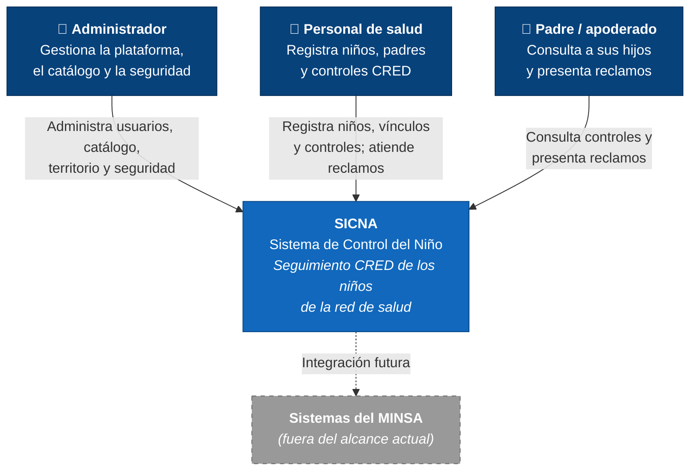

# Nivel 1 · Diagrama de contexto del sistema

> **Proyecto:** SICNA · **Modelo:** C4 · Nivel 1 de 4

---

## 1. Objetivo

Mostrar **SICNA como una sola caja**: quiénes lo usan y con qué sistemas se comunica.

| Aspecto | Descripción |
|---|---|
| Pregunta que responde | ¿Qué es el sistema, quién lo usa y con quién se integra? |
| Audiencia | Todos: red de salud, docentes, equipo de desarrollo |
| Qué **no** muestra | Tecnologías, servidores ni módulos internos |
| Siguiente nivel | [Nivel 2 · Contenedores](nivel-2-contenedores.md) |

---

## 2. Diagrama

---

## 3. Personas (usuarios)

| Persona | Descripción | Qué hace en el sistema |
|---|---|---|
| **Administrador** | Responsable de la operación de la plataforma | Gestiona usuarios, roles, permisos, micro redes, establecimientos y el catálogo; revisa la auditoría, las sesiones, los dispositivos y las alertas |
| **Personal de salud** | Coordinador o personal de un establecimiento | Registra niños y padres, los vincula, registra los controles CRED y responde los reclamos |
| **Padre / apoderado** | Familiar responsable del niño | Usa el portal familiar para ver a sus hijos y sus controles, y presenta reclamos con evidencias |

---

## 4. Sistemas

| Sistema | Tipo | Responsabilidad | Quién lo construye |
|---|---|---|---|
| **SICNA** | Sistema en alcance | Seguimiento de los controles CRED y portal familiar | El equipo del proyecto |
| **Sistemas del MINSA** | Externo (futuro) | Fuente oficial de información de salud | Ministerio de Salud |

---

## 5. Relaciones

| Origen | Destino | Descripción |
|---|---|---|
| Administrador | SICNA | Administra la plataforma |
| Personal de salud | SICNA | Registra la atención de los niños |
| Padre / apoderado | SICNA | Consulta y reclama |
| SICNA | Sistemas del MINSA | Integración prevista a futuro; hoy no existe |

---

## 6. Decisiones y supuestos

| # | Decisión o supuesto | Motivo |
|---|---|---|
| 1 | En esta versión SICNA no depende de sistemas externos | Simplifica el despliegue y las pruebas; el catálogo SISNAT se carga como datos |
| 2 | Los padres solo ven información de sus propios hijos | Protección de datos de menores (Ley N.° 29733) |
| 3 | Una integración futura se haría con un adaptador | Gracias a Clean Architecture, no cambiaría el negocio |
