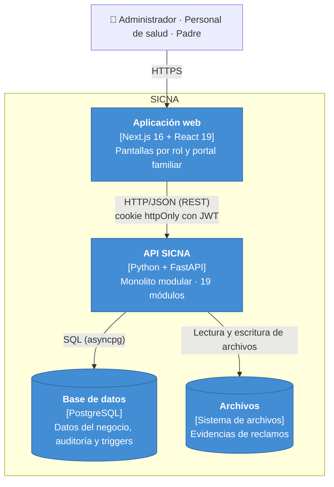

# Nivel 2 · Diagrama de contenedores

> **Proyecto:** SICNA · **Modelo:** C4 · Nivel 2 de 4

---

## 1. Objetivo

Abrir la caja «SICNA» del nivel 1 y mostrar los **contenedores**: las aplicaciones y los almacenes de datos que se ejecutan por separado, su tecnología y cómo se comunican.

| Aspecto | Descripción |
|---|---|
| Pregunta que responde | ¿De qué piezas ejecutables se compone el sistema y con qué tecnología? |
| Audiencia | Arquitectos y desarrolladores |
| Qué es un contenedor | Algo que se ejecuta o guarda datos de forma independiente (no es lo mismo que un contenedor Docker) |
| Nivel anterior | [Nivel 1 · Contexto](nivel-1-contexto.md) |
| Siguiente nivel | [Nivel 3 · Componentes](nivel-3-componentes.md) |

---

## 2. Diagrama

---

## 3. Contenedores

| Contenedor | Tecnología | Responsabilidad | Datos que maneja |
|---|---|---|---|
| **Aplicación web** | Next.js 16, React 19, Tailwind 4 | Interfaz del administrador, del personal de salud y del portal familiar. Sus *server actions* llaman a la API | Ninguno persistente; reenvía las cookies de sesión |
| **API SICNA** | Python, FastAPI, asyncpg | Expone la API REST, aplica las reglas de negocio, la autenticación y los permisos. Es un **monolito modular**: un solo proceso con 19 módulos | Ninguno propio; usa la base de datos y los archivos |
| **Base de datos** | PostgreSQL | Guarda la información y ejecuta la auditoría y las reglas de integridad con triggers | Usuarios, niños, padres, catálogo, controles, reclamos, sesiones, dispositivos, alertas y auditoría |
| **Archivos** | Sistema de archivos (`uploads/`) | Guarda las evidencias de los reclamos | Imágenes JPG/PNG y documentos PDF |

---

## 4. Relaciones

| Origen | Destino | Descripción | Protocolo |
|---|---|---|---|
| Usuarios | Aplicación web | Usan el sistema desde el navegador | HTTPS |
| Aplicación web | API SICNA | Llama a la API | HTTP/JSON con cookie `access_token` |
| API SICNA | Base de datos | Lee y escribe datos; envía el contexto de auditoría | SQL sobre TCP |
| API SICNA | Archivos | Guarda, lee y borra evidencias | Acceso a disco |

---

## 5. Decisiones arquitectónicas reflejadas

| Decisión | Alternativa descartada | Motivo |
|---|---|---|
| Un único contenedor de backend (monolito modular) | Microservicios | Equipo pequeño y plazo de un ciclo |
| Frontend separado del backend (Next.js + API REST) | Páginas generadas por el backend | Cada parte evoluciona por separado |
| PostgreSQL | Base de datos NoSQL | Los datos son relacionales (niño, padre, control, prestación) y se necesitan transacciones, restricciones y triggers |
| JWT en cookie `httpOnly` + sesión en base de datos | JWT en `localStorage` | El token no es accesible desde JavaScript y la sesión se puede revocar |
| Auditoría en la base de datos (triggers) | Auditoría escrita en cada servicio | No depende de que cada programador la recuerde |

---

## 6. Seguridad entre contenedores

| Comunicación | Medida |
|---|---|
| Navegador → aplicación web | HTTPS en producción (`COOKIE_SECURE=true`) |
| Aplicación web → API | JWT en cookie `httpOnly` y `SameSite=Lax`; en cada petición se verifica que la sesión siga activa |
| API → base de datos | Credenciales en variables de entorno (`.env`), que no se suben al repositorio |
| Contraseñas | Guardadas con Argon2, nunca en texto plano |
