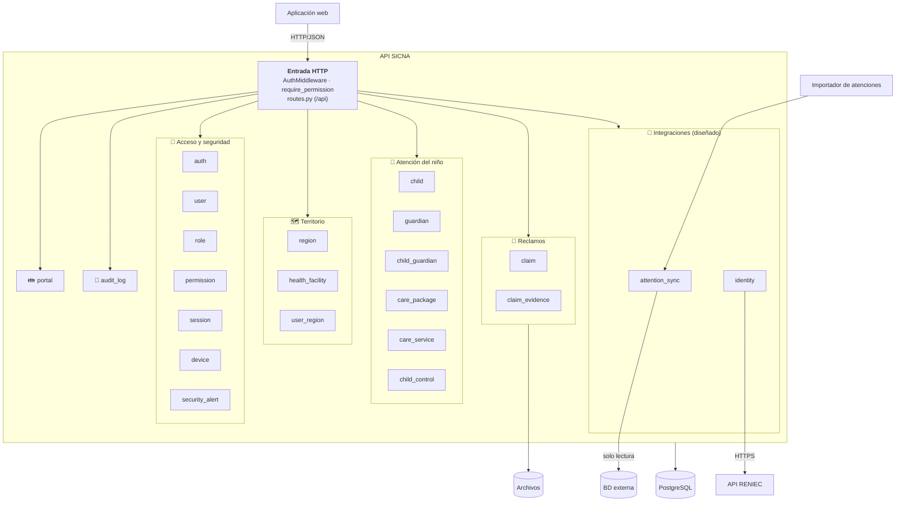
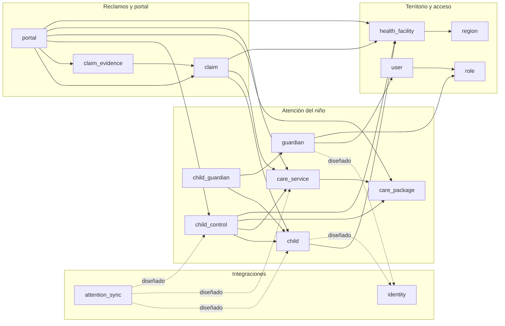

# Nivel 3 · Diagrama de componentes

> **Proyecto:** SICNA · **Contenedor detallado:** API SICNA (y el importador, que usa los mismos módulos) · **Modelo:** C4 · Nivel 3 de 4

---

## 1. Objetivo

Abrir el contenedor **API SICNA** del nivel 2 y mostrar sus **componentes**: los módulos del monolito, qué hace cada uno y cómo se relacionan.

| Aspecto | Descripción |
|---|---|
| Pregunta que responde | ¿Cómo se divide el backend por dentro y qué hace cada parte? |
| Audiencia | Arquitectos y desarrolladores |
| Qué es un componente | En SICNA, cada **módulo** del monolito es un componente |
| Nivel anterior | [Nivel 2 · Contenedores](nivel-2-contenedores.md) |
| Siguiente nivel | [Nivel 4 · Código](nivel-4-codigo.md) |

---

## 2. Diagrama general

> El diagrama general muestra **cómo se agrupan** los módulos. Las dependencias entre ellos se muestran por separado abajo para que se lean con claridad.

---

## 3. Dependencias entre módulos

Cada flecha significa "**usa a**", siempre mediante un **puerto** declarado en el dominio del módulo que llama y un **adaptador** en su infraestructura.

| Origen | Destino | Para qué | Puerto que usa el origen |
|---|---|---|---|
| child | health_facility | Validar que el establecimiento exista y esté activo | `HealthFacilityPort` |
| child, guardian | identity *(diseñado)* | Autocompletar y validar datos con RENIEC | `IdentityLookupPort` |
| child_control | child, care_service, care_package, health_facility | Validar las reglas del control | `ChildPort`, `CareServicePort`, `CarePackagePort`, `HealthFacilityPort` |
| attention_sync *(diseñado)* | child, care_service, child_control | Emparejar cada atención y actualizar el control | `ChildLookupPort`, `CareServiceLookupPort`, `ChildControlPort` |
| claim | child, care_service, health_facility | Validar el reclamo y completar datos del niño | `ChildPort`, `CareServicePort`, `HealthFacilityPort` |
| claim_evidence | claim | Verificar que el reclamo exista y no esté cerrado | `ClaimPort` |
| guardian | user, role | Crear la cuenta del portal del padre | `UserAccountPort`, `PasswordHasherPort` |
| portal | claim, claim_evidence, child_control, catálogo | Armar la vista del padre | `ClaimsPort`, `EvidencesPort`, `CatalogPort` |
| auth | user, role, device, session, security_alert | Iniciar sesión de forma segura | `UserPort`, `DevicePort`, `SessionPort`, `SecurityScanPort`… |

---

## 4. Componentes

| Componente | Responsabilidad | Ruta de la API | Usuario principal |
|---|---|---|---|
| **Entrada HTTP** | Autenticación, permisos, registro de rutas y manejo de errores | `/api` | Todos |
| **auth** | Iniciar sesión, cerrar sesión, usuario actual | `/api/auth` | Todos |
| **user** · **role** · **permission** | Cuentas, roles y permisos (RBAC) | `/api/users`, `/api/roles`, `/api/permissions` | Administrador general |
| **session** · **device** · **security_alert** | Sesiones, dispositivos y alertas de riesgo | `/api/sessions`, `/api/devices`, `/api/security-alerts` | Administrador general |
| **region** · **health_facility** · **user_region** | Micro redes, establecimientos y su asignación al personal | `/api/regions`, `/api/health-facilities`, `/api/user-regions` | Administrador general |
| **child** | Niños del padrón | `/api/children` | Coordinador |
| **guardian** · **child_guardian** | Padres o apoderados y su vínculo con los niños | `/api/guardians`, `/api/child-guardians` | Coordinador |
| **care_package** · **care_service** | Catálogo SISNAT: paquetes y prestaciones por edad | `/api/care-packages`, `/api/care-services` | Administrador general |
| **child_control** | Controles CRED de cada niño | `/api/child-controls` | Coordinador |
| **claim** · **claim_evidence** | Reclamos y sus evidencias | `/api/claims`, `/api/claim-evidences` | Coordinador |
| **portal** | Vista del padre: sus hijos, controles y reclamos | `/api/portal` | Padre / apoderado |
| **audit_log** | Consulta de la auditoría | `/api/audit-logs` | Administrador general |
| **identity** *(diseñado)* | Consulta de DNI en RENIEC | `/api/identity/{dni}` | Administradores |
| **attention_sync** *(diseñado)* | Carga de atenciones e historial de cargas | `/api/attention-sync` | Administrador general |

---

## 5. Relaciones con datos y sistemas externos

| Componente | Destino | Descripción | Patrón aplicado |
|---|---|---|---|
| Todos los módulos | PostgreSQL | Cada módulo lee y escribe sus propias tablas | Repository |
| claim, claim_evidence | Archivos | Guardar y borrar evidencias | Adapter (`FileStoragePort` → `LocalFileStorage`) |
| identity | API de RENIEC | Consultar datos por DNI | Adapter (`IdentityProviderPort` → `ReniecApiAdapter`) + caché |
| attention_sync | BD externa de atenciones | Leer atenciones nuevas | Adapter (`AttentionSourcePort` → `ExternalDbAttentionSource`) |
| Entrada HTTP | PostgreSQL | Enviar usuario, dispositivo e IP para la auditoría | Contexto de auditoría |

---

## 6. Reglas del monolito modular

| # | Regla | Motivo |
|---|---|---|
| 1 | Todos los módulos se despliegan juntos; el importador reutiliza el mismo código | Es un monolito: una sola base de código |
| 2 | Un módulo usa a otro solo mediante un **puerto propio** y un **adaptador** | Un cambio interno en un módulo no rompe a los demás |
| 3 | El dominio y la aplicación de un módulo nunca importan las capas `application/`, `infrastructure/` ni `presentation/` de otro | Se cumple la regla de dependencia de Clean |
| 4 | Cada sistema externo se integra en **un solo módulo** (RENIEC en `identity`, la BD externa en `attention_sync`) | La integración queda en un solo lugar y es fácil de reemplazar |
| 5 | Cada módulo se organiza por dentro con Clean Architecture | Las reglas del negocio no dependen de la tecnología (ver nivel 4) |

> **Excepción conocida:** `portal` es un módulo **agregador** (arma la vista del padre a partir de varios módulos), así que sus puertos devuelven directamente las entidades de dominio de los otros módulos. Depender del dominio de otro módulo es aceptable, porque es la capa más estable.
