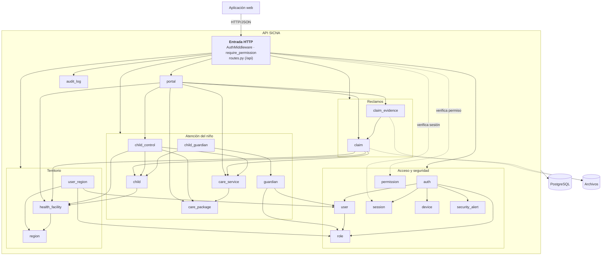

# Nivel 3 · Diagrama de componentes

> **Proyecto:** SICNA · **Contenedor detallado:** API SICNA · **Modelo:** C4 · Nivel 3 de 4

---

## 1. Objetivo

Abrir el contenedor **API SICNA** del nivel 2 y mostrar sus **componentes**: los módulos del monolito, qué hace cada uno y cómo se relacionan.

| Aspecto | Descripción |
|---|---|
| Pregunta que responde | ¿Cómo se divide el backend por dentro y qué hace cada parte? |
| Audiencia | Arquitectos y desarrolladores |
| Qué es un componente | En SICNA, cada **módulo** del monolito es un componente |
| Nivel anterior | [Nivel 2 · Contenedores](nivel-2-contenedores.md) |
| Siguiente nivel | [Nivel 4 · Código](nivel-4-codigo.md) |

---

## 2. Diagrama

> Las flechas entre módulos son llamadas en memoria **a través de puertos y adaptadores**: el módulo que llama declara una interfaz en su dominio y un adaptador en su infraestructura consulta al otro módulo.

---

## 3. Componentes

| Componente | Responsabilidad | Ruta de la API | Carpeta |
|---|---|---|---|
| **Entrada HTTP** | Autenticación, permisos, registro de rutas y manejo de errores | `/api` | `src/core/` |
| **auth** | Iniciar sesión, cerrar sesión, usuario actual | `/api/auth` | `modules/auth/` |
| **user** | Cuentas de usuario | `/api/users` | `modules/user/` |
| **role** · **permission** | Roles y permisos (RBAC) | `/api/roles`, `/api/permissions` | `modules/role/`, `modules/permission/` |
| **session** · **device** | Sesiones activas y dispositivos; revocar o bloquear | `/api/sessions`, `/api/devices` | `modules/session/`, `modules/device/` |
| **security_alert** | Detectar cuentas o dispositivos compartidos | `/api/security-alerts` | `modules/security_alert/` |
| **region** · **health_facility** · **user_region** | Micro redes, establecimientos y su asignación al personal | `/api/regions`, `/api/health-facilities`, `/api/user-regions` | `modules/…` |
| **child** | Niños del padrón | `/api/children` | `modules/child/` |
| **guardian** · **child_guardian** | Padres o apoderados y su vínculo con los niños | `/api/guardians`, `/api/child-guardians` | `modules/…` |
| **care_package** · **care_service** | Catálogo SISNAT: paquetes y prestaciones por edad | `/api/care-packages`, `/api/care-services` | `modules/…` |
| **child_control** | Controles CRED de cada niño | `/api/child-controls` | `modules/child_control/` |
| **claim** · **claim_evidence** | Reclamos y sus evidencias | `/api/claims`, `/api/claim-evidences` | `modules/…` |
| **portal** | Vista del padre: sus hijos, controles y reclamos | `/api/portal` | `modules/portal/` |
| **audit_log** | Consulta de la auditoría | `/api/audit-logs` | `modules/audit_log/` |

---

## 4. Relaciones entre componentes

| Origen | Destino | Para qué | Puerto que usa el origen |
|---|---|---|---|
| child | health_facility | Validar que el establecimiento exista y esté activo | `HealthFacilityPort` |
| child_control | child, care_service, care_package, health_facility | Validar las reglas del control | `ChildPort`, `CareServicePort`, `CarePackagePort`, `HealthFacilityPort` |
| claim | child, care_service, health_facility | Validar el reclamo y completar datos del niño | `ChildPort`, `CareServicePort`, `HealthFacilityPort` |
| claim_evidence | claim | Verificar que el reclamo exista y no esté cerrado | `ClaimPort` |
| guardian | user, role | Crear la cuenta del portal del padre | `UserAccountPort`, `PasswordHasherPort` |
| portal | claim, claim_evidence, child_control, catálogo | Armar la vista del padre | `ClaimsPort`, `EvidencesPort`, `CatalogPort` |
| auth | user, role, device, session, security_alert | Iniciar sesión de forma segura | `UserPort`, `DevicePort`, `SessionPort`, `SecurityScanPort`… |

---

## 5. Relaciones con datos

| Componente | Destino | Descripción | Patrón aplicado |
|---|---|---|---|
| Todos los módulos | PostgreSQL | Cada módulo lee y escribe sus propias tablas | Repository |
| claim, claim_evidence | Archivos | Guardar y borrar evidencias | Adapter (`FileStoragePort` → `LocalFileStorage`) |
| Entrada HTTP | PostgreSQL | Enviar usuario, dispositivo e IP para la auditoría | Contexto de auditoría |

---

## 6. Reglas del monolito modular

| # | Regla | Motivo |
|---|---|---|
| 1 | Todos los módulos se despliegan juntos en la API SICNA | Es un monolito: un solo proceso |
| 2 | Un módulo usa a otro solo mediante un **puerto propio** y un **adaptador** | Un cambio interno en un módulo no rompe a los demás |
| 3 | El dominio y la aplicación de un módulo nunca importan las capas `application/`, `infrastructure/` ni `presentation/` de otro | Se cumple la regla de dependencia de Clean |
| 4 | Cada módulo se organiza por dentro con Clean Architecture | Las reglas del negocio no dependen de la tecnología (ver nivel 4) |

> **Excepción conocida:** `portal` es un módulo **agregador** (arma la vista del padre a partir de varios módulos), así que sus puertos devuelven directamente las entidades de dominio de los otros módulos. Depender del dominio de otro módulo es aceptable, porque es la capa más estable.
