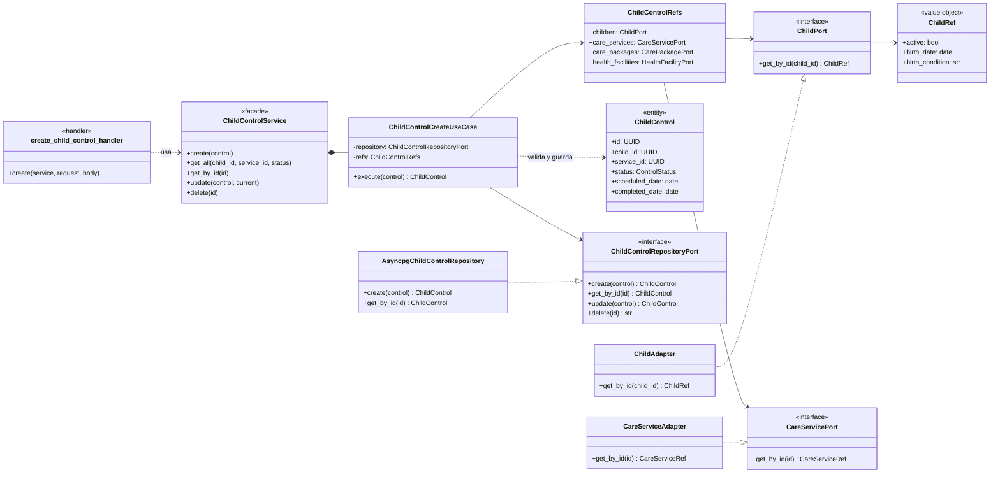
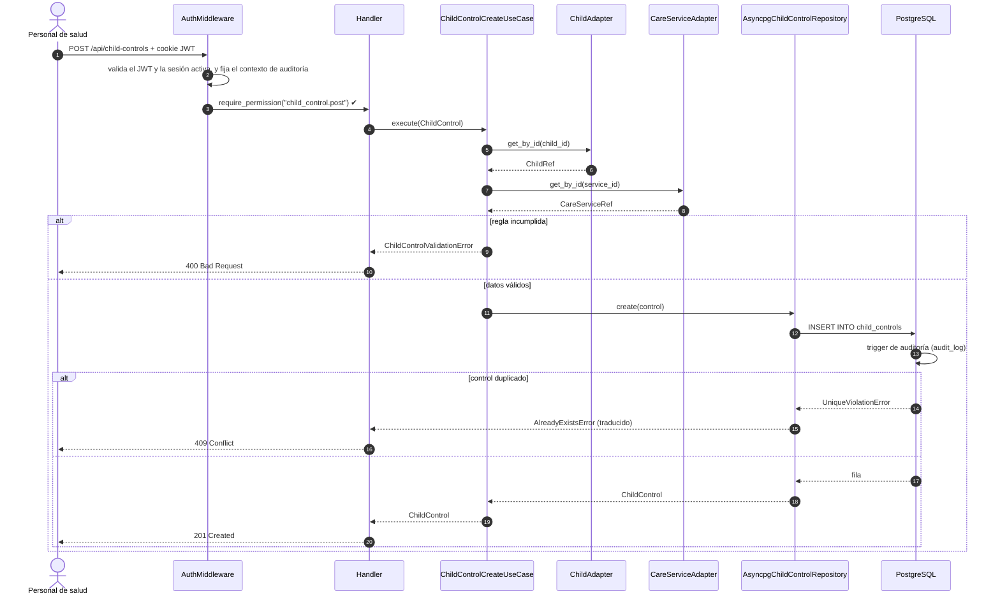

# Nivel 4 · Diagrama de código

> **Proyecto:** SICNA · **Módulo detallado:** Controles CRED (`child_control`) · **Modelo:** C4 · Nivel 4 de 4 · **Notación:** UML

---

## 1. Objetivo

Mostrar **cómo está organizado el código** de un componente del nivel 3: sus clases, interfaces y cómo colaboran. Se detalla el flujo **Registrar control CRED**.

| Aspecto | Descripción |
|---|---|
| Pregunta que responde | ¿Qué clases existen dentro de un módulo y cómo se relacionan? |
| Audiencia | Desarrolladores |
| Por qué solo un módulo | El nivel 4 es opcional en C4 y se dibuja solo para los componentes más importantes. Los otros 18 módulos siguen la misma estructura |
| Nivel anterior | [Nivel 3 · Componentes](nivel-3-componentes.md) |

---

## 2. Diagrama de clases

### 2.1 Capas de Clean Architecture

| Capa | Contiene | Regla |
|---|---|---|
| **Presentación** | Handlers, rutas, presenter | Traduce HTTP a llamadas del caso de uso y viceversa |
| **Aplicación** | Casos de uso, `ChildControlRefs`, validaciones | Coordina los pasos; no conoce la tecnología |
| **Dominio** | `ChildControl`, puertos, `ChildRef` | Reglas y contratos; no importa nada de las otras capas |
| **Infraestructura** | Repositorio asyncpg, adaptadores | Implementa los puertos del dominio |

> **Regla de dependencia:** las flechas apuntan hacia el dominio. La infraestructura implementa los puertos (línea discontinua con triángulo); el dominio nunca conoce a la infraestructura.

### 2.2 Clases del módulo

| Clase | Tipo | Capa | Responsabilidad |
|---|---|---|---|
| `create_child_control_handler` | Handler | Presentación | Arma la entidad a partir del JSON y responde 201, 400 o 409 |
| `ChildControlService` | Fachada | Aplicación | Agrupa los 5 casos de uso del módulo |
| `ChildControlCreateUseCase` | Caso de uso | Aplicación | Valida las reglas RN-01 a RN-07 y guarda el control |
| `ChildControlRefs` | Parameter Object | Aplicación | Agrupa los 4 puertos hacia otros módulos |
| `ChildControl` | Entidad | Dominio | Representa un control CRED |
| `ChildControlRepositoryPort` | Interfaz | Dominio | Contrato para guardar y buscar controles |
| `ChildPort`, `CareServicePort`, … | Interfaces | Dominio | Contrato para consultar otros módulos |
| `ChildRef`, `CareServiceRef`, … | Objetos de valor | Dominio | Solo los datos que el módulo necesita de otro |
| `AsyncpgChildControlRepository` | Repositorio | Infraestructura | Implementa el puerto con PostgreSQL |
| `ChildAdapter`, `CareServiceAdapter`, … | Adaptadores | Infraestructura | Consultan otros módulos y traducen a `*Ref` |

### 2.3 Notación UML utilizada

| Símbolo | Significado | Ejemplo |
|---|---|---|
| Línea continua con flecha | Asociación: guarda una referencia | `ChildControlCreateUseCase` → `ChildControlRepositoryPort` |
| Línea discontinua con flecha | Dependencia: la usa | handler ⇢ `ChildControlService` |
| Línea discontinua con triángulo hueco | Realización: implementa una interfaz | `AsyncpgChildControlRepository` ▷ `ChildControlRepositoryPort` |
| Rombo relleno | Composición | `ChildControlService` ◆ `ChildControlCreateUseCase` |
| «interface» | Interfaz (`Protocol` en Python) | `ChildPort` |

---

## 3. Diagrama de secuencia: registrar control CRED

---

## 4. Patrones y principios que se ven en este nivel

| Elemento del diagrama | Patrón o principio |
|---|---|
| `ChildAdapter`, `CareServiceAdapter` | Patrón **Adapter** |
| `ChildControlRepositoryPort` y `AsyncpgChildControlRepository` | Patrón **Repository** |
| `translate_db_errors` sobre el repositorio | Patrón **Decorator** |
| `ChildControlService` | Patrón **Facade** |
| El caso de uso recibe interfaces, no clases concretas | Principio de **inversión de dependencias** (SOLID) |
| `ChildRef` solo con 3 datos del niño | Principio de **segregación de interfaces** (SOLID) |

> Detalle en [Patrones de diseño](../03-diseno-de-software/02-patrones-de-diseno.md) y [Principios de diseño](../03-diseno-de-software/03-principios-de-diseno.md).
